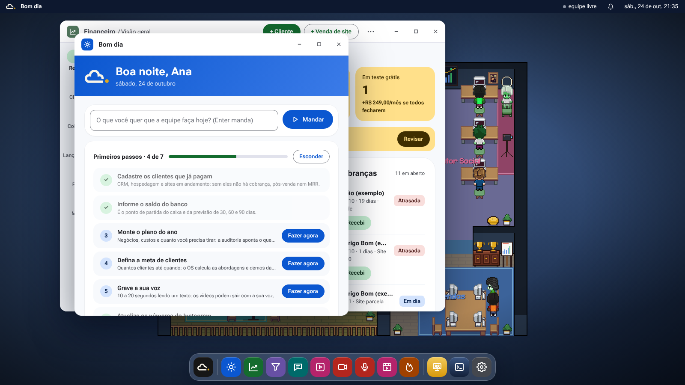
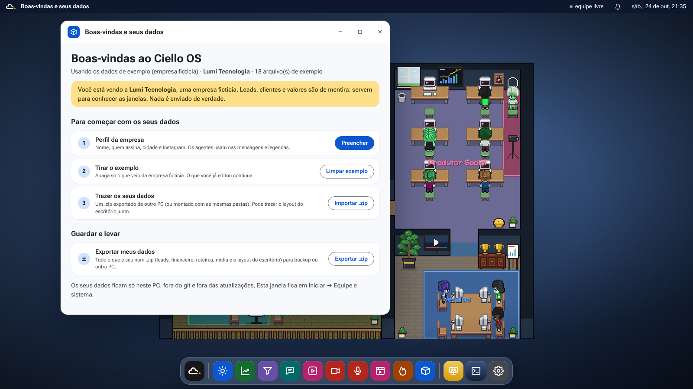
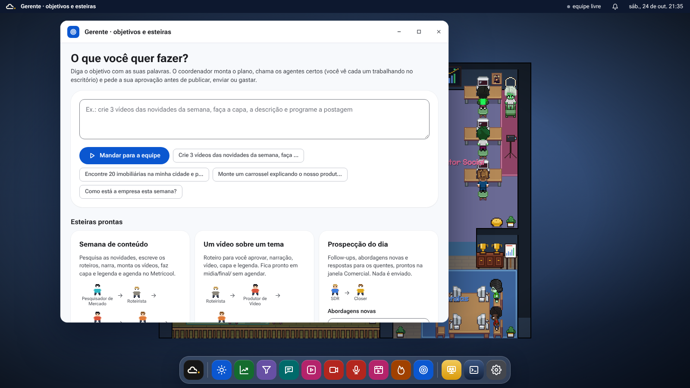
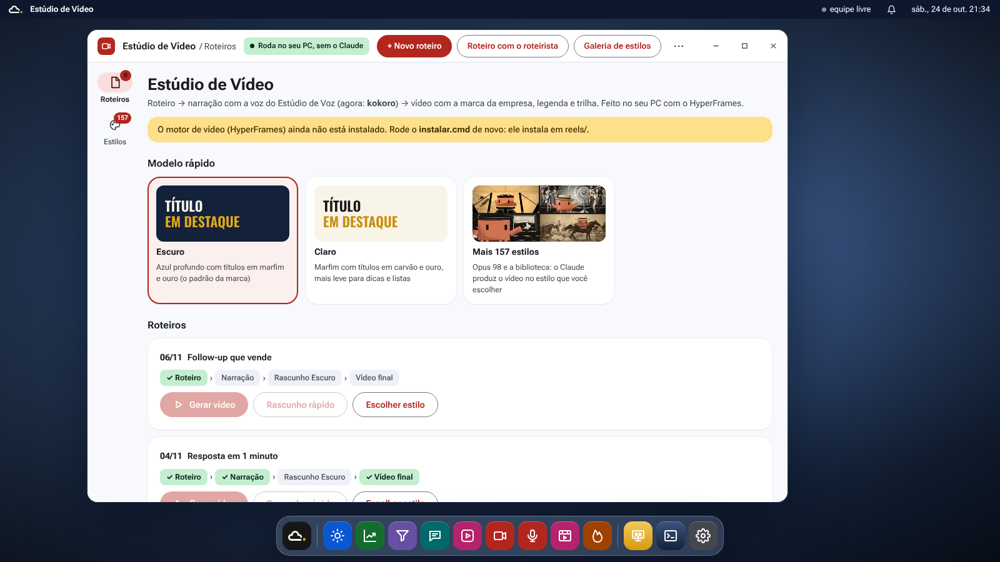
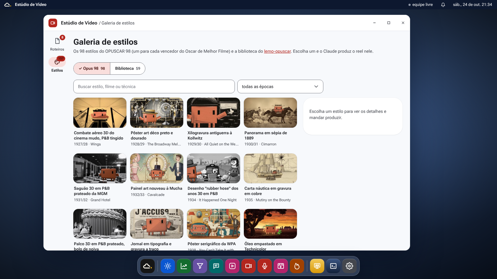
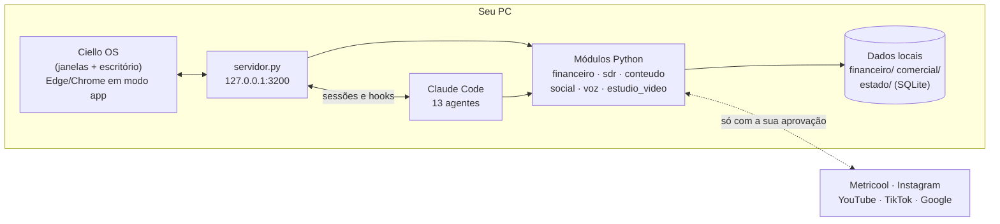

<p align="center">
  
</p>

<p align="center">
  <b>Uma equipe de agentes de IA que cuida do marketing, do comercial e do financeiro de uma pequena empresa.</b><br>
  Roda no seu PC, numa área de trabalho própria, e só publica, envia ou gasta com a sua aprovação.
</p>

<p align="center">
  
  
  
  
</p>

---

## O que é

O **Ciello OS** é um assistente comercial e de marketing para micro e pequenas empresas, feito pela CIELLO. Ele chega com uma empresa fictícia de exemplo (a Lumi Tecnologia) para você conhecer tudo cheio; na janela **Boas-vindas e seus dados** você preenche o perfil da sua empresa, limpa o exemplo e importa os seus dados. Ele começou como um agente que fazia os reels da semana e virou um sistema completo: uma área de trabalho com barra de tarefas e janelas, em que cada janela é um setor da empresa, e um **escritório em pixel art** onde os 13 agentes "trabalham" à vista.

Você diz o que quer ("crie 3 vídeos das novidades da semana e programe a postagem", "encontre 20 imobiliárias na sua cidade"), o **Gerente** monta o plano, chama os agentes certos e você acompanha cada um andando até a mesa e trabalhando. Quando algo precisa de você (aprovar um roteiro, mandar uma mensagem, gastar dinheiro), ele pede.

<p align="center">
  
  <br><sub>Bom dia e Financeiro abertos sobre o escritório. Todas as capturas usam dados fictícios.</sub>
</p>

<p align="center">
  
  <br><sub>Boas-vindas e seus dados: abre sozinha na primeira vez.</sub>
</p>

## O que ele faz

| Área | O que resolve | Janela |
|---|---|---|
| **Bom dia** | As 3 prioridades do dia, com quem resolve cada uma, e os primeiros passos de quem está começando | `Bom dia` |
| **Gerente** | Recebe um objetivo em texto livre, monta a esteira e delega; esteiras prontas para semana de conteúdo, prospecção, anúncios e fechamento da semana | `Gerente · objetivos e esteiras` |
| **Conteúdo** | Pauta a partir do que está viralizando, roteiro, narração, vídeo, capa e legenda, até o agendamento | `Conteúdo e Instagram` |
| **Rede social** | Piloto automático (ou aprovação post a post) para Instagram, TikTok e YouTube Shorts, calendário do mês e caixa de comentários | `Rede social`, `Conexões` |
| **Estúdio de Voz** | Grava a sua voz, testa vozes prontas (Kokoro) ou clonadas (Chatterbox, VoiceStudio) e escolhe a voz dos vídeos | `Estúdio de Voz` |
| **Estúdio de Vídeo** | Roteiro → narração → vídeo com a marca, legenda karaokê e trilha, feito no próprio PC. Na **Galeria de estilos** você escolhe um dos 157 estilos (os 98 do OPUSCAR 98 e a biblioteca do lemo-opuscar) e o Claude produz o vídeo nele | `Estúdio de Vídeo` |
| **Comercial** | Leads do Google Maps, qualificação, 1ª mensagem por WhatsApp, cadência de follow-up, agenda de demos e exportação para o CRM | `Comercial` |
| **Financeiro** | Assinaturas, faturas, cobrança, extrato bancário, caixa e previsão, MRR, churn, CAC e LTV, plano do ano e metas | `Financeiro` |
| **Atendimento** | Acha no FAQ a resposta para a pergunta do cliente, pronta para o WhatsApp | `Atendimento` |
| **Anúncios** | Público, criativos, orçamento e o que medir em campanhas Meta | `Anúncios` |
| **Mercado** | Tendências por pilar de conteúdo e vigia de preço e oferta dos concorrentes | `Tendências`, `Concorrentes` |

As janelas de Financeiro, Comercial, Conteúdo, Anúncios e os dois Estúdios **funcionam sem o Claude**: os formulários rodam direto no seu PC. O Claude Code entra quando você pede algo para a equipe fazer.

<table>
  <tr>
    <td width="50%"><br><sub><b>Gerente.</b> Escreva o objetivo ou rode uma esteira pronta.</sub></td>
    <td width="50%"><br><sub><b>Conteúdo.</b> Cada post mostra a etapa em que está e quem faz a próxima.</sub></td>
  </tr>
  <tr>
    <td><br><sub><b>Comercial.</b> Funil, leads quentes para responder hoje e venda para quem já é cliente.</sub></td>
    <td><br><sub><b>Financeiro.</b> MRR dos últimos 6 meses e previsão de caixa para 30, 60 e 90 dias.</sub></td>
  </tr>
  <tr>
    <td><br><sub><b>Estúdio de Voz.</b> A sua voz ou uma voz pronta em todos os vídeos.</sub></td>
    <td><br><sub><b>Estúdio de Vídeo.</b> Modelos na identidade da empresa e a fila de roteiros.</sub></td>
  </tr>
  <tr>
    <td colspan="2"><br><sub><b>Galeria de estilos.</b> Escolha um estilo do Opus 98 ou da biblioteca e o Claude produz o reel nele.</sub></td>
  </tr>
</table>

## O escritório dos agentes

<p align="center"></p>

O fundo do Ciello OS é um escritório com uma sala para cada time (**Gerente**, **Comercial**, **Produtor Social** e **Vendas**), além de Arquivos, Copa, Área de lazer e Varanda. A sala do Gerente é fechada por uma porta de carvalho e ele não sai de lá, então você sempre sabe onde achá-lo. Esse é o layout padrão; você pode montar o seu no editor e levá-lo de um PC para outro no .zip de dados. Cada sessão do Claude Code aberta na pasta do assistente vira um personagem: ele vai até a mesa quando começa uma tarefa, digita enquanto trabalha e avisa quando precisa de você. Agentes parados vão tomar café, sentar no sofá ou pegar um ar na varanda. Clicar num personagem abre a janela daquele agente.

O escritório nasceu como fork do [pixel-agents](https://github.com/pablodelucca/pixel-agents) (MIT) e hoje é servido por um núcleo próprio em Python, sem Node. Detalhes em [`escritorio/README.md`](escritorio/README.md).

## A equipe

Treze agentes especialistas em [`.claude/agents/`](.claude/agents/), coordenados pelo Gerente:

| Conteúdo | Comercial | Gestão |
|---|---|---|
| Pesquisador de Mercado · Roteirista · Produtor de Vídeo · Produtor de Imagem · Postagem · Analista | SDR · Closer · Gestor de Anúncios | Gerente · Financeiro · Caixa de Entrada · Sucesso do Cliente |

Comandos prontos no Claude Code: `/bom-dia`, `/semana`, `/comercial`, `/segunda`, `/sexta` e `/conselho`. Função e ferramentas de cada agente em [`docs/equipe.md`](docs/equipe.md).

## Alguns reels que ele já produziu

<p align="center">
  
  
  
  
  
</p>

Os vídeos ficam em [`midia/`](midia/) e o que já foi ao ar em [`historico.md`](historico.md).

## Como funciona



- **Tela:** HTML, CSS e JavaScript puros em [`central/escritorio/web/`](central/escritorio/web/), abertos numa janela de app do Edge ou Chrome.
- **Servidor:** [`central/escritorio/servidor.py`](central/escritorio/servidor.py), só com a biblioteca padrão do Python, escutando apenas em `127.0.0.1`.
- **Dados:** tudo fica no PC. O que vem do Metricool e das redes é copiado para um banco local (`estado/ciello.db`), então desconectar um serviço não apaga histórico.
- **Vídeo:** Remotion e HyperFrames em [`reels/`](reels/); narração com Kokoro, Chatterbox ou VoiceStudio; mixagem com ffmpeg.

## Instalação

**Windows 10 ou 11 (recomendado):**

1. Baixe o **`CielloOS-Setup-<versão>.exe`** em [Releases](https://github.com/MTCiello/AGENTE-DE-POSTAGEM/releases) e clique duas vezes.
2. Escolha a pasta e o tipo de instalação (Padrão, ou Completa com o Estúdio de Voz).
3. O instalador baixa sozinho o que falta: Python 3.12, Git, FFmpeg, Node.js, Claude Code, as bibliotecas, o gerador de vídeo e o buscador do SDR.
4. Abra pelo ícone **Ciello OS** na área de trabalho. Ele procura atualizações no GitHub e pergunta antes de instalar; dá para procurar na mão em **Atualizações**.

<p align="center"></p>

Detalhes, canais de atualização e como publicar uma versão nova em [`docs/instalador.md`](docs/instalador.md).

**Pela pasta clonada (desenvolvimento):**

1. Baixe o repositório (ZIP ou `git clone`).
2. Prepare as dependências: `powershell -ExecutionPolicy Bypass -File instalador\preparar.ps1` (acrescente `-Voz` para a voz, uns 3 GB).
3. Abra com `.venv\Scripts\pythonw.exe instalador\lancador.pyw` (é o mesmo que o ícone do instalador abre). A verificação fica no menu Iniciar do Ciello OS.

Para o Bom dia sair sozinho às 7h e o piloto da rede social rodar de hora em hora: `python instalador\rotinas.pyw ligar` (ou o botão **Rodar de hora em hora** em Rede social).

<details>
<summary>Rodar em Linux ou macOS (desenvolvimento)</summary>

```bash
python3 -m venv .venv && . .venv/bin/activate
pip install -r central/requirements.txt          # base: numpy e soundfile
pip install -r central/requirements-voz.txt      # opcional: voz (Kokoro, Chatterbox, Whisper)
python central/escritorio/servidor.py            # abre em http://127.0.0.1:3200
```

</details>

## Atualizações

> **Em construção.** O gerenciador de atualizações vai procurar versões novas neste repositório sozinho ou quando você pedir. Até lá, atualize com `git pull` na pasta do assistente (ou baixe o ZIP de novo, guardando antes as pastas `comercial\`, `financeiro\`, `estado\` e `founder\`).

## Estrutura do repositório

```
.
├── instalador/              instalador do Windows (CielloOS-Setup.exe), ícone e atualizações · VERSION
├── central/                 o programa em Python
│   ├── escritorio/          Ciello OS: servidor, tela (web/) e núcleo do escritório (nucleo/)
│   ├── provedores/          Metricool, Instagram, YouTube, TikTok
│   ├── clone/               notebook do clone digital (Kaggle)
│   ├── testes/              testes automáticos (sem internet)
│   └── *.py                 financeiro, sdr, conteudo, social, voz, briefing, radar...
├── escritorio/              a tela do escritório em pixel art (React + canvas, fork do pixel-agents)
├── reels/                   gerador de vídeo (Remotion e HyperFrames)
├── .claude/                 os 13 agentes e os comandos (/bom-dia, /semana, ...)
├── roteiros/ midia/         roteiros em JSON, vídeos e capas publicados
├── exemplo/                 a empresa fictícia (Lumi Tecnologia) que vem com o Ciello OS
├── conhecimento/ radar/     biblioteca de ganchos e tendências
├── metricas/                retratos semanais do Instagram e relatórios
├── comercial/ financeiro/ anuncios/ founder/   os seus dados (fora do git, como marca/, roteiros/ e midia/)
├── docs/                    documentação (índice em docs/README.md)
├── AGENTE.md                procedimento semanal do agente de conteúdo
└── historico.md             o que já foi postado
```

## Documentação

O índice completo está em [`docs/README.md`](docs/README.md). Os mais usados:

- [`docs/instalador.md`](docs/instalador.md): instalador do Windows e atualizações
- [`docs/equipe.md`](docs/equipe.md): os agentes e os comandos
- [`docs/rede-social.md`](docs/rede-social.md): piloto automático da rede social
- [`docs/app-comercial.md`](docs/app-comercial.md): arquitetura do conteúdo até a venda
- [`central/README.md`](central/README.md): cada script, o fluxo de um reel e a voz

## Testes

```bash
python -m unittest discover central/testes          # Python, sem internet
cd escritorio/webview-ui && npm install && npm test # tela do escritório
```

## Privacidade e regras da casa

- **Nada é publicado, enviado ou pago sem o seu ok.** Os agentes preparam; você aprova.
- **Os seus dados ficam no seu PC.** Leads, clientes, faturas, extratos, gravações de voz e o plano de negócio estão no `.gitignore` e nunca sobem para este repositório, que é público.
- O servidor só escuta em `127.0.0.1` e os botões das janelas só rodam uma lista fixa de ações, com um token por sessão.

## Créditos e licenças

- Escritório: fork do [pixel-agents](https://github.com/pablodelucca/pixel-agents) v1.5.0, MIT, © Pablo De Lucca ([`escritorio/LICENSE`](escritorio/LICENSE)).
- Skills `founder-*`: [founder-skill](https://github.com/Jakeschincariol/founder-skill), MIT ([`.claude/skills/FOUNDER-LICENSE.txt`](.claude/skills/FOUNDER-LICENSE.txt)).
- Fontes Inter e Oswald: SIL Open Font License ([`central/escritorio/web/fontes/LICENCA.txt`](central/escritorio/web/fontes/LICENCA.txt)).
- Galeria de estilos: [lemo-opuscar](https://github.com/lemomo-ai/lemo-opuscar) da LemoLab, guias MIT e quadros CC BY 4.0 ([`reels/estilos/LICENCA.md`](reels/estilos/LICENCA.md)).
- Voz: [Kokoro](https://github.com/hexgrad/kokoro), [Chatterbox](https://github.com/resemble-ai/chatterbox) e [faster-whisper](https://github.com/SYSTRAN/faster-whisper); o VoiceStudio (AGPL-3.0) roda como programa separado.

---

<p align="center"><sub>Feito pela <b>CIELLO</b> · Tecnologia que eleva</sub></p>
