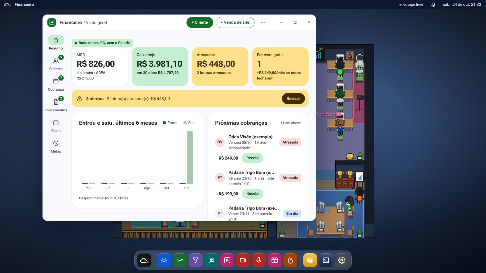
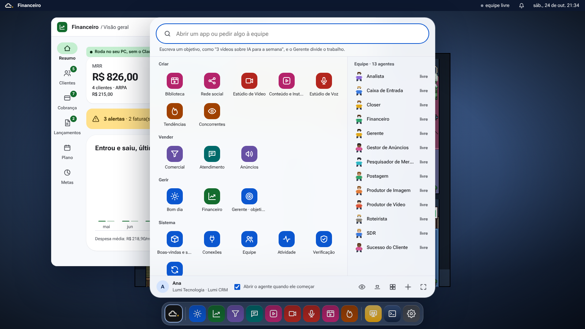
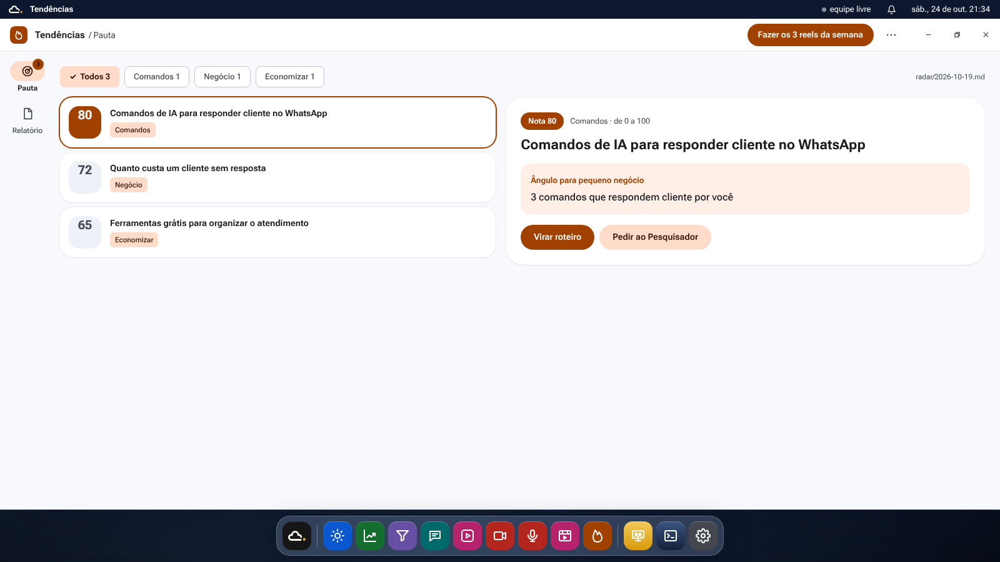
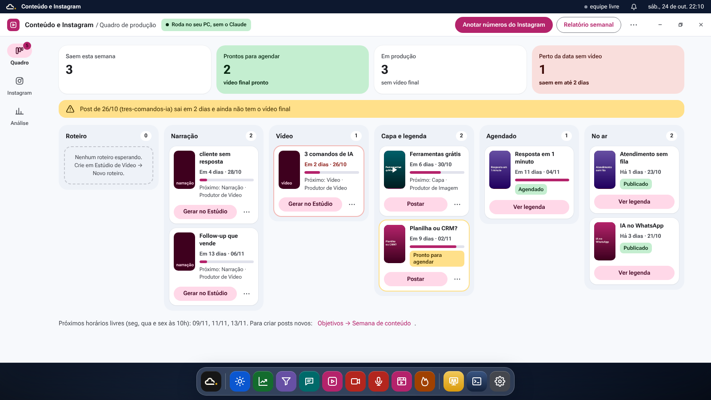
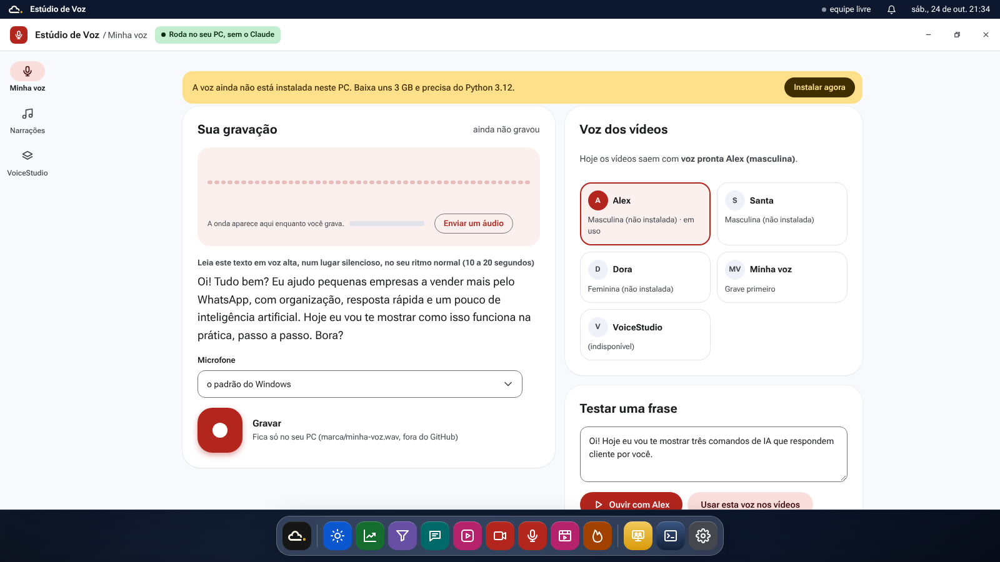
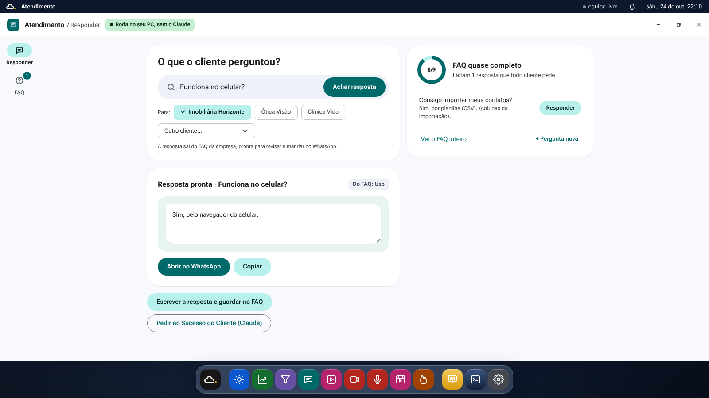
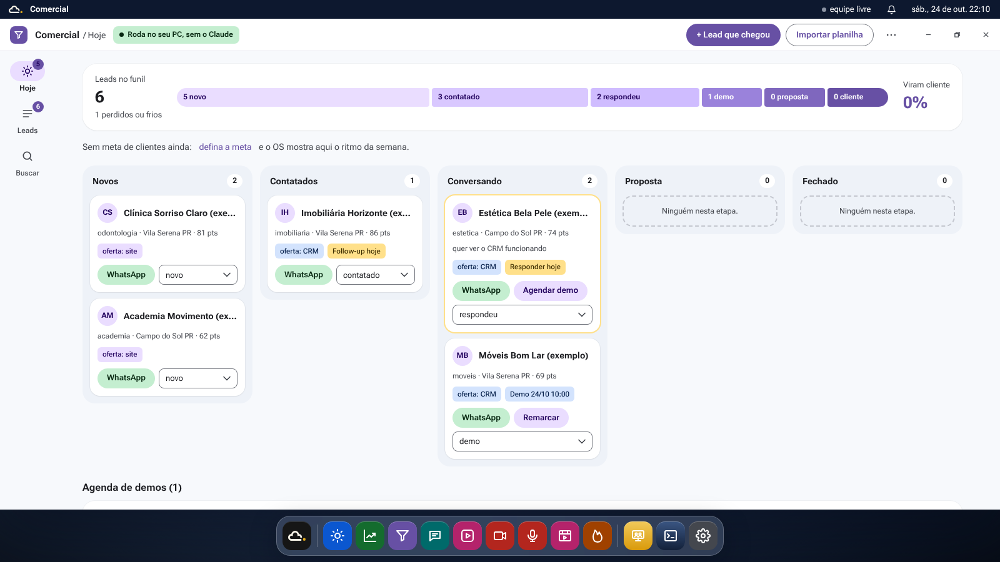
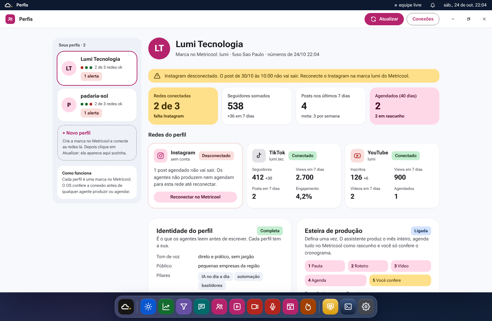
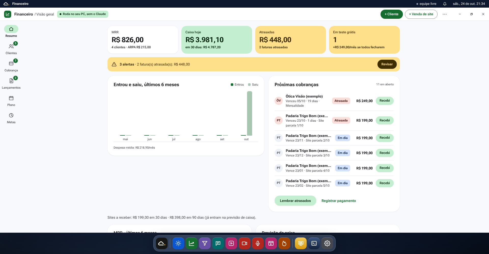

# Sistema visual do Ciello OS

Referência curta para quem mexe em `central/escritorio/web/`. O estilo segue o Material 3 do Google: colorido, denso e com componentes de cantos bem arredondados. Cada app tem uma cor própria, todas as janelas têm a mesma estrutura e as superfícies ficam neutras, para que a cor apareça só onde ajuda.

## Base

| Item | Valor |
|---|---|
| Letra | Roboto Flex em tudo (`--fonte`), na pasta `web/fontes/` e sem depender de CDN. Inter fica de reserva; Oswald só na marca do papel de parede |
| Tamanhos | 13–14 px no corpo, 15/650 no título da janela, 20–22/700 no título de painel, 26–30/700 nos números grandes |
| Fundo | `--fundo` #F7F9FC (página), `--superficie` #EEF2F8 (colunas, trilho, caixas), `--cartao` #FFFFFF |
| Contornos | `--contorno` #74777F (campos), `--contorno-forte` #C4C7CF, `--contorno-suave` #E1E2EC |
| Texto | `--texto` #1B1C20, secundário `--texto-2` #44474E |
| Cor do sistema | `--os` #0B57D0, `--os-container` #D3E3FD, `--os-on` #041E49 |
| Grade | múltiplos de 8 px (4 px em ajustes finos) |
| Raios | 8 chips (`--r-chip`), 12 campos (`--r-campo`), 16–20 cartões (`--r-cartao`), 28 painéis e diálogos (`--r-painel`), 999 botões |

As variáveis estão no `:root` de `app.css`. Use sempre a variável, nunca a cor solta. Os nomes antigos (`--azul`, `--tinta`, `--cinza`, `--linha`…) continuam como apelidos dos novos, para o HTML que já os usa.

## Uma cor por app

Cada app pinta com a sua cor o ícone, a seleção do trilho, o botão principal, os links e os gráficos. O resto da janela fica neutro. A cor vem de `TEMAS` em `app.js`: o app diz o tema em `APPS` (`tema: 'conteudo'`) e `abrir()` põe três variáveis na janela.

| Tema | Apps | `--app` | `--app-container` | `--app-on` |
|---|---|---|---|---|
| conteudo | Perfis, Conteúdo, Biblioteca, Rede social | #B4236B | #FFD8E8 | #3E001E |
| tendencias | Tendências, Concorrentes | #A04100 | #FFDBC9 | #351000 |
| estudio | Estúdio de Voz, Estúdio de Vídeo | #B3261E | #F9DEDC | #410E0B |
| atendimento | Atendimento | #006A6A | #B8F0EE | #002020 |
| financeiro | Financeiro | #146C2E | #C4EED0 | #072711 |
| comercial | Comercial, Anúncios | #6750A4 | #EADDFF | #21005D |
| os | todos os outros (Bom dia, Gerente, Equipe, Boas-vindas…) | #0B57D0 | #D3E3FD | #041E49 |

`--selecao`, `--foco` e `--app-suave` são calculadas a partir da cor do app, então um componente novo que use essas variáveis já sai na cor certa em qualquer janela.

## Estrutura da tela

- **Barra de cima** (30 px): marca, nome do app ativo, estado da equipe, avisos e relógio.
- **Dock** flutuante embaixo: botão Iniciar, apps fixos (`NO_DOCK` em `app.js`), janelas abertas com um traço azul-claro embaixo e atalhos do sistema. Cada ícone tem a cor do seu app.
- **Menu Iniciar** no estilo Spotlight: campo de busca que também manda pedidos à equipe, apps por grupo (`GRUPOS`) e a lista de agentes com o estado de cada um.

## Janela

- **Barra de título** (52 px, branca): ícone do app na cor dele, o nome e a seção atual ("Financeiro / Visão geral"). À direita ficam as ações da tela e os botões minimizar, maximizar e fechar.
- **Ações**: a tela escreve os botões em `.acoes.topo` como sempre e `arrumar(j)` leva-os para a barra. Cabem de 1 a 3, conforme a largura, e o resto vai para o menu `…`.
- **Chip "Roda no seu PC, sem o Claude"**: a tela põe `SEM_CLAUDE` no conteúdo. Com a janela larga (960 px ou mais), ele sobe para a barra de título; com a janela estreita, fica no topo do conteúdo.
- **Trilho de navegação** (88 px): as abas (`abas(j, lista)`) viram o trilho do Material 3, com ícone, nome curto e indicador em pílula de 56 × 32 na seção escolhida. Os ícones vêm de `ICONE_ABA`, os nomes curtos de `ROTULO_CURTO`, e a contagem vira um selo no ícone. Uma lista curta de modos, que muda só a vista e não a seção, usa `nav.abas.seg` e fica no conteúdo como controle segmentado.
- **Lista e detalhe**: para escolher um item e ver os detalhes (como em Tendências), a lista fica à esquerda e o item escolhido à direita. Com a janela estreita, as duas colunas viram uma.

## Componentes

| Componente | Classe | Uso |
|---|---|---|
| Botão principal | `.bt.pri` | cheio, na cor do app; um por área |
| Botão com tom | `.bt.tom` | fundo `--app-container`; segunda ação ou ação de cartão |
| Botão com contorno | `.bt` | contorno cinza e texto na cor do app |
| Botão de texto | `.bt.fantasma` | ações leves, como "Registrar pagamento" |
| Botão pequeno | `.bt.mini` | 32 px, dentro de cartões e linhas |
| Botões | — | pílula de 40–44 px de altura |
| Números grandes | `.kpis` + `.kpi` (`.verde`, `.amarelo`, `.vermelho`, `.app`) | a fileira que abre cada painel |
| Cartão | `.cartao` | raio 20, branco, sombra leve |
| Painel | `.painel` | raio 28, para blocos grandes (gráfico, gravação, resposta) |
| Chip de estado | `.chip` (`pronto`, `trabalhando`, `esperando`, `erro`, `parado`) | raio 8, cor fixa |
| Faixa de avisos | `faixaAvisos(lista, resumo)` | vários avisos viram uma faixa amarela só: "N avisos · o primeiro" e um botão Revisar que abre a lista |
| Quadro | `.kanban` + `.coluna` + `.cartao-k` | etapas lado a lado (Conteúdo, Comercial) |
| Tocador | `tocador(src, rótulo)` | substitui o `<audio controls>` do navegador: botão redondo, trilha e tempo |
| Campos | `input`, `select`, `textarea` | contorno 1 px #74777F, raio 12, 44 px de altura; foco na cor do app |
| Tabela | `table.tab` | cabeçalho cinza, linhas alternadas e destaque ao passar o mouse |
| Tela vazia | `.vazio`, `.vazio-coluna` | borda tracejada, explica o que vai aparecer e tem um botão para começar |

## Regras

1. **Resumo primeiro.** Todo app abre com 3 ou 4 números grandes do que importa hoje (`.kpi`). O detalhe vem embaixo.
2. **Uma ação principal.** Um botão cheio (`.bt.pri`) por área. Os outros ficam com tom ou contorno, ou no menu de três pontos.
3. **Estado com cor fixa.** Verde para pronto, azul para em produção, amarelo para esperando você e vermelho para atrasado, sempre com texto junto (`.chip`). Nunca use cor solta para dizer estado.
4. **Menu lateral igual.** Todo app usa o mesmo trilho à esquerda, com ícone e nome. Quem aprende um sabe usar todos.
5. **Mostrar, não listar.** Vídeo tem miniatura, voz tem onda sonora e dinheiro tem gráfico. Texto corrido só onde é leitura.
6. **Tela vazia ensina.** Quando não há nada, a tela diz o que vai aparecer ali e tem um botão para começar.

E valem sempre: texto em frase normal, sem CAIXA ALTA em títulos; alvos clicáveis com pelo menos 28 px; foco visível com `--foco`; contraste de pelo menos 4,5:1; e botões de verdade (`<button>`) para toda ação.

## Telas com layout próprio

Estas telas seguem o seu próprio desenho. As outras usam os mesmos tokens, o trilho e os componentes acima.

- **Conteúdo, aba Quadro**: números da semana (saem esta semana, prontos para agendar, em produção, perto da data sem vídeo), uma faixa de avisos e o quadro com as colunas Roteiro, Narração, Vídeo, Capa e legenda, Agendado e No ar. Cada post é um cartão com miniatura (capa ou vídeo), data (vermelha quando atrasa), barra de etapas, chip de estado, a próxima ação com tom e o resto no menu `…`.

  

- **Tendências, aba Pauta**: chips por pilar com a contagem, um chip vermelho quando alguma fonte falhou, a lista de pautas com a nota de 0 a 100 num quadrado (cheio a partir de 75) e, ao lado, o detalhe com o ângulo para pequeno negócio e as ações Virar roteiro e Pedir ao Pesquisador.
- **Estúdio de Voz, aba Minha voz**: painel da gravação com a onda sonora, o tocador, o medidor do microfone, o texto para ler em letra grande e o botão de gravar (72 px). Ao lado, as vozes em cartões, com a que está em uso marcada, e o teste de uma frase. Narrações e VoiceStudio ficam em outras abas do trilho.

  

- **Atendimento, aba Responder**: busca grande "O que o cliente perguntou?", chips para escolher o cliente e a resposta pronta num balão de WhatsApp com Abrir no WhatsApp e Copiar. Ao lado, o anel de quanto o FAQ está completo e as perguntas que faltam responder.

  

- **Financeiro, aba Visão geral**: MRR, caixa hoje, atrasadas e em teste nos números grandes; faixa de avisos; o gráfico "Entrou e saiu, últimos 6 meses" ao lado das próximas cobranças, com o botão Recebi em cada uma; depois o MRR, a previsão de caixa e as despesas por categoria.
- **Comercial, aba Hoje**: o funil numa barra só (leads no funil, cada etapa e quanto vira cliente) e o quadro dos leads por etapa (Novos, Contatados, Conversando, Proposta e Fechado), com os 6 de mais pontos em cada coluna e o resto na aba Leads. Embaixo continuam a agenda de demos, os follow-ups e as abordagens.

  

- **Perfis**: um perfil por marca do Metricool (a sua empresa é o primeiro; cada cliente é outro). A lista dos perfis fica à esquerda, com bolinhas por rede e o chip de alertas, e o "Novo perfil" explica que basta criar a marca no Metricool. À direita: faixa de avisos (rede desconectada, post agendado que não vai sair), números grandes (redes conectadas, seguidores, posts em 7 dias, agendados), um cartão por rede com os números da semana e, embaixo, a identidade do perfil e a esteira de produção ("Produzir o próximo mês" manda o pedido à equipe; tudo vai ao Metricool como rascunho).

  

## Layout de cada tela

Cada tela tem um tipo de layout (`ux` em `APPS`, tabela `LAYOUTS` em `app.js`). Ele fixa o tamanho mínimo e máximo da janela e a largura máxima do conteúdo: abaixo do mínimo a tela quebraria, acima do máximo os botões e gráficos esticariam. Maximizada, a janela ocupa a tela toda e o conteúdo fica centralizado na largura do layout.

| Layout | Telas | Janela mín. | Janela máx. | Conteúdo máx. |
|---|---|---|---|---|
| Painel | Perfis, Financeiro, Comercial, Conteúdo, Rede social, Anúncios, Biblioteca | 760 × 480 | 1440 × 960 | 1180 |
| Lista | Tendências, Equipe, Atendimento, Conexões | 640 × 440 | 1200 × 960 | 1040 |
| Estúdio | Estúdio de Vídeo, Estúdio de Voz, Gerente (objetivos) | 720 × 520 | 1320 × 960 | 1120 |
| Leitura | Bom dia, cada agente, Boas-vindas, Concorrentes | 520 × 420 | 900 × 900 | 760 |
| Compacta | Atividade, Atualizações | 420 × 340 | 720 × 760 | 640 |
| Terminal | Claude Code, execução | 520 × 320 | a tela | sem limite |

Uma página com quadro (`.kanban`) pode ir até 1440 px, para caberem as 5 ou 6 colunas. As telas de duas colunas (Atendimento, Estúdio de Voz, lista e detalhe) viram uma coluna quando a janela fica abaixo de 860 px de conteúdo; a regra usa a largura da janela (`@container janela`), não a da tela do PC.

Dentro da tela também há limites: gráfico de barras até 760 px com colunas de no máximo 44 px, funil até 640 px, botão até a largura da linha (na barra de título, até 220 px), campo de texto até 520 px, e imagem e vídeo nunca passam da largura nem perdem a proporção. Uma tela nova escolhe um destes layouts; se nenhum servir, crie outro na tabela em vez de mudar o tamanho na mão.

## Capturas

As capturas de `img/` usam só dados fictícios (veja o [índice](README.md#imagens)).
