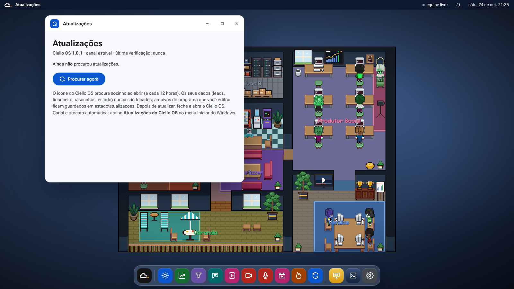

# Instalador e atualizações do Ciello OS

## Para quem vai usar (Windows 10 ou 11)

1. Baixe o **`CielloOS-Setup-<versão>.exe`** na página de [Releases](https://github.com/MTCiello/AGENTE-DE-POSTAGEM/releases) e clique duas vezes.
   Se o Windows avisar "o Windows protegeu o computador": **Mais informações → Executar assim mesmo** (o instalador ainda não tem assinatura digital).
2. Escolha a **pasta** (padrão `C:\Ciello\CielloOS`; evite OneDrive) e o tipo de instalação:
   - **Padrão:** Ciello OS + Claude Code + Estúdio de Vídeo.
   - **Completa:** tudo isso + **Estúdio de Voz** (Kokoro, Chatterbox e Whisper, uns 3 GB a mais).
   - **Personalizada:** marque só o que quiser.
   Se quiser, marque **Rotinas automáticas** (o Bom dia às 7h e o piloto da rede social de hora em hora).
3. No fim o próprio instalador baixa e instala as dependências, sem abrir janela de CMD nem de Python: a tela
   **Preparando o seu computador** mostra a etapa e a barra de andamento (Python 3.12, Git, FFmpeg, Node.js, Claude Code,
   as bibliotecas do Python no `.venv`, o Remotion/HyperFrames, o buscador do SDR e, se marcou, a voz).
   Demora de 10 a 30 minutos na primeira vez. O log fica em `estado\instalacao.log`.
4. Pronto: o ícone **Ciello OS** aparece na área de trabalho e no menu Iniciar. Ele liga o servidor escondido (o que ele
   escreve fica em `estado\servidor.log`) e abre o Ciello OS numa janela própria. Para desligar: menu Iniciar do
   Ciello OS, botão **Desligar** (o ícone de energia).

No menu Iniciar, na pasta **Ciello OS**, também ficam: **Atualizações do Ciello OS**, **Reinstalar dependências** (abre
a janela de Atualizações e mostra o andamento lá, sem CMD) e **Desinstalar**. Desinstalar apaga o programa e o que foi baixado (`.venv`, `node_modules`), mas **mantém os seus dados**
(`estado`, `comercial`, `financeiro`, `founder`, `audio`) na pasta.

## Atualizações

- **Sozinho:** ao abrir pelo ícone, o Ciello OS procura versão nova no GitHub (no máximo a cada 12 horas, sem travar
  se estiver sem internet). Se tiver, pergunta se quer atualizar.
- **Na mão:** Ciello OS → menu Iniciar → **Atualizações → Procurar agora**, ou o atalho **Atualizações do Ciello OS** no
  menu Iniciar do Windows (é ali que se escolhe o canal e liga/desliga a procura automática).
- **Canais:** *Estável* = as Releases publicadas (tags `vX.Y.Z`). *Teste* = o último commit da `main`,
  para testar antes de publicar. Se a pasta foi clonada com Git, a atualização é um `git pull --ff-only`.
- **Seus dados não são tocados:** `.venv`, `estado`, leads e abordagens, `financeiro`, `founder`, áudios, rascunhos do
  Estúdio e `node_modules` ficam fora da atualização. Arquivo do programa que você editou à mão é copiado antes para
  `estado\atualizacoes\<data>\backup\`. Se `requirements` ou `package.json` mudarem, as dependências são reinstaladas.
- Pelo terminal: `python instalador\atualizacao.py verificar | aplicar | status [--canal estavel|teste]`.

## Para publicar uma versão nova

1. Mude o número no arquivo `VERSION` (ex.: `1.1.0`) e leve o commit para a `main`.
2. O GitHub Actions (`.github/workflows/instalador.yml`) roda os testes, compila o `CielloOS-Setup-1.1.0.exe` com o
   Inno Setup, cria a tag `v1.1.0` e publica a Release. A partir daí, todos os PCs no canal estável veem a atualização.
   (Criar a tag na mão, `git tag v1.1.0 && git push origin v1.1.0`, também publica.)

Para só gerar o `.exe` sem publicar: **Actions → Instalador → Run workflow** (o arquivo sai em *Artifacts*).

## Arquivos

| Arquivo | O que faz |
|---|---|
| `instalador/ciello.iss` | Assistente de instalação (Inno Setup): pasta, componentes, atalhos com o ícone |
| `instalador/preparar.ps1` | Baixa e instala as dependências (winget, com download direto de reserva) |
| `instalador/lancador.pyw` | O que o ícone abre: procura atualização e liga o Ciello OS sem janela |
| `instalador/rotinas.pyw` | Liga/desliga o Bom dia (7h) e o piloto (de hora em hora) no Agendador do Windows, sem janela |
| `instalador/atualizacao.py` | Gerenciador de atualizações (GitHub Releases, branch de teste ou Git) |
| `instalador/atualizador.pyw` | Janela de Atualizações do Windows |
| `instalador/gerar_icone.py` | Gera `instalador/marca/ciello.ico` e as imagens do instalador (logo sobre o Azul profundo `#263A59`) |
| `VERSION` | Versão instalada; a tag da Release tem de bater com ela |

Não há mais `.cmd` (`instalar`, `Ciello`, `testar`, `agendar`): tudo passa pelo instalador e pelo ícone. Quem atualiza
um PC antigo tem esses arquivos apagados da pasta. Na pasta clonada, veja o README ("Pela pasta clonada").
